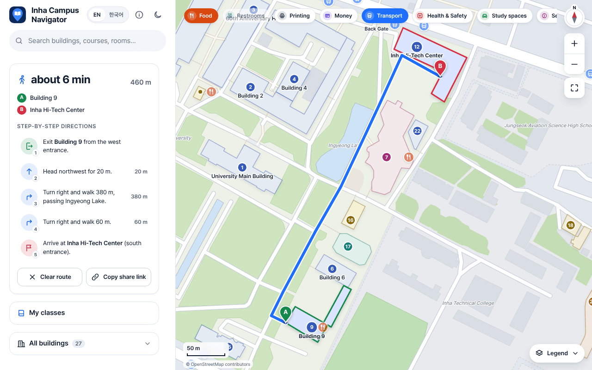
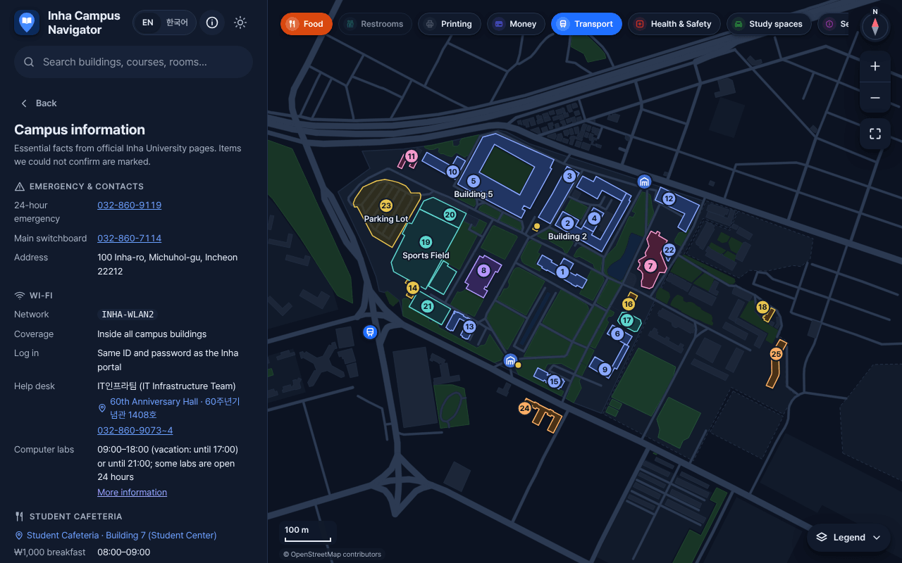
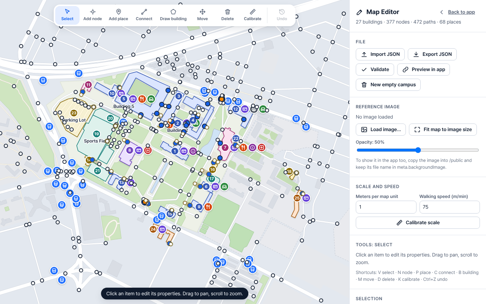

# Inha Campus Navigator

A walking map of **Inha University's Yonghyeon campus** (인하대학교 용현캠퍼스, 100 Inha-ro, Incheon) for students, especially new and international students. You can:

- find a building, a department office, a room code such as `2남 212호` or a café;
- get the shortest walking route with step-by-step directions in English or Korean.

**Live:** <https://inha-campus-navigator.vercel.app>

The map uses real geometry from OpenStreetMap. Building names and numbers, department offices, campus offices, Wi-Fi, the cafeteria and transport come from official Inha University pages. **Nothing is invented:** every fact has a source, and what could not be confirmed is shown as _Not yet verified_ instead of being guessed. See [Where the data comes from](#where-the-data-comes-from).

> This is a student project, not an official Inha University service.

---

## Screenshots

| Route with directions                                                              | Building: departments, offices, amenities                                        |
| ---------------------------------------------------------------------------------- | -------------------------------------------------------------------------------- |
|  |  |

| Campus info (dark mode)                                       | Phone                                              | Map Editor                                     |
| ------------------------------------------------------------- | -------------------------------------------------- | ---------------------------------------------- |
|  |  |  |

---

## Features

- **Real campus map**:
  - all 25 numbered buildings and facilities from the official campus map, plus 2 named in OpenStreetMap;
  - real paths, gates and surrounding streets, drawn from OpenStreetMap, with attribution.
- **Shortest walking routes along real paths.** Dijkstra's algorithm runs on a graph built from OpenStreetMap walkways and picks the best entrance at both ends. Every pair of buildings is reachable (tested).
- **Step-free option.** It avoids stairs and entrances mapped as not step-free, and prefers entrances mapped as step-free. If no stair-free route exists, it says so.
- **Directions with landmarks.** Turns are given only at real decision points, together with:
  - road names ("along Soseong-ro") and landmarks passed (the library, Ingyeong Lake, the Main Building);
  - road crossings and stairs.
- **Find nearest…** restroom, printer, food, café, convenience store, cafeteria, ATM or bus stop, by walking distance from your start.
- **Use my location.** The GPS fix appears as a "you are here" dot with an accuracy circle, and the nearest building becomes the start.
  - If accuracy is worse than 50 m, you're asked to confirm the building.
  - The position never leaves the device.
- **Room search.** Typing a timetable room code (`2남 212호`, `하이테크 1012`, `60주년 901A호`) shows the building, wing and floor, with a route.
- **My classes.** Your own timetable, saved only in your browser, shows the next class with a one-tap route.
- **Building panel:**
  - names, number, a short bilingual description, and departments with their office floor, room and phone;
  - a floor directory, and amenities with their verification status;
  - a licensed photo or a designed fallback card, every source, "last verified", and **Report a mistake**.
- **Map filters** for Food, Restrooms, Printing, Money, Transport, Health & Safety, Study spaces and Services. Level of detail by zoom, and labels that never overlap.
- **Campus info**: emergency numbers, Wi-Fi guide, cafeteria hours, health center and student support, transport and the shuttle bus, all sourced. **About** covers data freshness, what the labels mean, sources and privacy.
- **Works offline** (PWA). It can be installed on a phone's home screen, and after the first visit it reloads without a connection.
- English / 한국어, light and dark mode, a phone layout with a bottom sheet, share links, recent routes, full keyboard use and screen-reader support.
- **Map Editor** (`?edit=1`) to correct the data visually. Corrections are saved as small "edits" files that survive rebuilding the data.

## Getting started

Requirements: [Node.js](https://nodejs.org) 22.12 or newer.

```bash
npm install
npm run dev        # http://localhost:5173/
```

| Command                  | What it does                                                      |
| ------------------------ | ----------------------------------------------------------------- |
| `npm run dev`            | Development server with hot reload                                |
| `npm test`               | All unit tests (Vitest)                                           |
| `npm run validate`       | Data checks (see [Validation](#validation-and-verification))      |
| `npm run build`          | Static site in `dist/` (`npm run preview` serves it)              |
| `npm run data:fetch-osm` | Download a fresh OpenStreetMap snapshot into `data-raw/osm/`      |
| `npm run data:build`     | Build `src/data/campus.json` from `data-raw/`                     |
| `npm run reports`        | Write `VERIFY.md`, `DATA-REPORT.md` and `PHOTOS-TODO.md`          |
| `npm run photos`         | Fetch Commons photos → optimize → rebuild data → photo to-do list |
| `npm run format`         | Prettier                                                          |

Useful URLs:

- `?from=b-9&to=b-hitech` opens a route.
- `?edit=1` opens the Map Editor.
- `?preview=1` runs the app on the editor's saved draft.

---

## Where the data comes from

| Data                                                                                       | Source                                                                                        | In the repo                                          |
| ------------------------------------------------------------------------------------------ | --------------------------------------------------------------------------------------------- | ---------------------------------------------------- |
| Building shapes, paths, entrances, gates, streets, amenities                               | [OpenStreetMap](https://www.openstreetmap.org/copyright) (© OpenStreetMap contributors, ODbL) | `data-raw/osm/` (snapshot with date)                 |
| Building numbers and official names (ko/en)                                                | inha.ac.kr campus map and building pages                                                      | `data-raw/official/buildings.json`                   |
| Department and college offices, campus offices, ATMs, Wi-Fi, cafeteria, transport, shuttle | inha.ac.kr and each department's homepage                                                     | `data-raw/official/details.json`                     |
| URL and retrieval date of every official page                                              | —                                                                                             | `data-raw/official-sources.json` (90 pages)          |
| Photos                                                                                     | Wikimedia Commons (CC BY-SA), or your own                                                     | `data-raw/photos/commons.json`, `public/photos/web/` |

**Status of each fact.** Every fact in `campus.json` carries one of four statuses:

| Status      | Meaning                                          | Shown as                            |
| ----------- | ------------------------------------------------ | ----------------------------------- |
| `verified`  | From an official Inha page, or checked on campus | Normally                            |
| `osm`       | From OpenStreetMap only                          | Normally, with a small info icon    |
| `estimated` | Derived by the build (e.g. a guessed entrance)   | Normally, with a small warning icon |
| `unknown`   | Not found yet                                    | "Not yet verified", in muted text   |

Descriptions are written by the build from these facts only: offices, facilities, and a location hint computed from the map. Inha Technical College (인하공업전문대학), next door, is a separate school. It is drawn only as background and is not in search or routing.

## Regenerating the data

```bash
npm run data:fetch-osm   # optional: new OSM snapshot (OSM API; needs network access to api.openstreetmap.org)
npm run data:build       # data-raw/ → src/data/campus.json (+ data-raw/build-report.json)
npm run validate
npm run reports
npm test
```

`scripts/build-campus.mjs` does the whole conversion:

1. It projects lat/lon to meters around the campus centre (`src/utils/projection.js`).
2. It matches official buildings to OSM outlines and simplifies the shapes.
3. It builds the walking graph (`scripts/lib/walk-graph.mjs`):
   - ways are split at junctions and keep their real length;
   - OSM entrances are snapped to the network;
   - an **estimated** entrance is created where none is mapped;
   - the network is checked for connectivity.
4. It attaches the official details (`scripts/lib/official-details.mjs`).
5. It adds the amenities (`scripts/lib/amenities.mjs`) and the photos.
6. Finally it applies your Map Editor edits.

The build is deterministic: the same inputs give the same `campus.json`.

To **add or fix an official fact**, edit `data-raw/official/details.json` (or `buildings.json`), add the page to `official-sources.json`, and rebuild. A department office written as a room code is placed automatically.

## Room-code format

Inha writes locations as **`<building> [wing] <room>[호]`**. Examples from official office listings:

| Written                    | Building       | Wing  | Floor | Room |
| -------------------------- | -------------- | ----- | ----- | ---- |
| `2남 212호`                | 2호관          | South | 2F    | 212  |
| `2호관 2북 291호`          | 2호관          | North | 2F    | 291  |
| `5동 213B호`               | 5호관          | East  | 2F    | 213B |
| `60주년기념관 1408호`      | 60주년기념관   | —     | 14F   | 1408 |
| `하이테크센터 1012`        | 하이테크센터   | —     | 10F   | 1012 |
| `정석학술정보관 5층 521호` | 정석학술정보관 | —     | 5F    | 521  |

- **Buildings.** A building is written by name or number, and the accepted spellings come from each building's `roomPrefixes`.
- **Wings.** Only 2호관 and 5호관 have wings: 동 east, 서 west, 남 south, 북 north.
- **Floors.** The floor is the room number without its last two digits. A leading `B` means a basement room.
- **Parser.** `parseRoomCode()` (`src/utils/roomCode.js`) is tolerant of spaces, hyphens and a missing 호, and is unit tested.
- **Timetables.** The public timetable pages could not be searched, so the exact notation printed on timetables is not confirmed yet. The format above comes from the official office listings.

## Photos

- **Wikimedia Commons.** `data-raw/photos/commons.json` lists the files used, with author, license and file page. Only free licenses are used: CC0, CC BY, CC BY-SA or public domain.
  - `npm run photos:fetch` re-checks each license with the Commons API and downloads the files.
  - `-- --search` lists candidate files for review.
  - `-- --via-proxy` is for networks that Wikimedia rate-limits, such as cloud containers.
  - Photos are always served from this site and never hotlinked.
- **Your own photos.** Save one as `public/photos/<buildingId>.jpg` (or `.png`/`.webp`), then run `npm run photos:optimize && npm run data:build`.
  - It takes priority over a Commons photo and is credited as "own work".
  - To credit someone else, add `{ "<id>": { "author": "…", "license": "…" } }` to `data-raw/photos/own.json`.
- **Output.** Photos are resized to WebP at 1200 px plus a 400 px thumbnail in `public/photos/web/`. Buildings without a photo show a fallback card with the category color, number and name.
- `PHOTOS-TODO.md` lists the missing photos as a walking route.

## Correcting data with the Map Editor

Open `?edit=1` (it loads as a separate chunk, only then). You can:

- select any building, entrance, path, place or area;
- drag nodes and building corners (paths follow);
- draw new buildings, entrances, paths and places.

The panel lets you set:

- floors and descriptions;
- each **amenity** and its status ("Verified" after you checked it on campus);
- step-free entrances, road crossings and stairs;
- each building's **Last verified** date.

**Validate** runs the app's checks, and **Preview in app** tests routing on your draft.

When done, click **Export edits**. This downloads `campus-edits-<date>.json` with only your changes, keyed by id. Put it in `data-raw/edits/` and run `npm run data:build`:

- edits are re-applied on every rebuild, in file-name order, so they survive new OSM snapshots;
- any edit whose target no longer exists is listed in `data-raw/build-report.json`;
- when you correct an amenity in the editor, your version replaces that building's whole `amenities` list.

For geometry errors, consider fixing OpenStreetMap itself too, so everyone benefits.

## Validation and verification

`npm run validate` checks that:

- every building has an id, both names, a polygon, an entrance and a bilingual description;
- every entrance is on the graph, and the graph is one connected network;
- a route exists between **all 351 building pairs**;
- no amenity is off campus;
- every `verified` fact has a source;
- every photo exists and is credited.

Buildings without an official number are reported as warnings.

`npm run reports` writes:

- **`VERIFY.md`**: a printable checklist for walking the campus in route order. It covers estimated entrances, unknown amenities per building, matches to confirm, path gaps, unplaced offices and missing photos.
- **`DATA-REPORT.md`**: counts, the share of verified / OSM / estimated / unknown facts, and every source URL.
- **`PHOTOS-TODO.md`**: missing photos.

**Known gaps** (also in VERIFY.md):

- Most amenities inside buildings (restrooms per floor, printers, elevators) are not published online and await an on-campus check.
- Library opening hours are not readable from the library site.
- No official page covers lost and found or the security office.
- No stairs are mapped in OpenStreetMap yet.

## Report a mistake

Every building panel and the Info panel has a **Report a mistake** link. It opens a pre-filled GitHub issue with the building id and its current data. To send reports by email instead, change `REPORT_TARGET` in `src/config.js`:

```js
export const REPORT_TARGET = { type: 'email', address: 'someone@example.com' };
```

## Building and deploying

- **Vercel**: `vercel.json` builds with `BASE_PATH=/` and publishes `dist/`. Import the repository; nothing else is needed.
- **GitHub Pages**: `npm run build` uses the base `/inha-campus-navigator/` by default. Override it with `BASE_PATH=/my-path/`. `.github/workflows/deploy.yml` tests, validates, builds and publishes on every push to `main` (enable _Settings → Pages → Source: GitHub Actions_).

The service worker (`public/sw.js`) caches pages network-first and hashed files, data and photos cache-first. Bump its `VERSION` to drop old caches. App icons are made from `public/favicon.svg` by `node scripts/make-icons.mjs`.

**Privacy.** No accounts, no analytics, no server. Your location and classes stay in the browser.

---

## How the routing works

1. **Graph.** Nodes are entrances, path junctions and gates; edges are walkways with their real length along the OSM geometry.
2. **Dijkstra** with a binary min-heap (`src/routing/dijkstra.js`, `minHeap.js`) finds the shortest path in `O((V + E) log V)`.
3. **Endpoints** (`endpoints.js`) are buildings (all their entrances) or places (an outdoor place joins at the nearest path node).
   - A virtual source and target node, linked to every entrance, let one Dijkstra run pick the best pair of doors.
   - With the step-free option, entrances get a small extra cost unless they are mapped as step-free, and stair edges are skipped.
4. **Find nearest** puts a virtual node behind every candidate, so a single run finds the closest one by walking distance.
5. **Directions** (`directions.js`) measure bearings over the first and last 10 m of each edge and announce turns only at real decision points. They mention the road followed, a landmark passed, road crossings and stairs, in both languages.

All of this is pure JavaScript without DOM access, and fully unit tested.

## Data format (`src/data/campus.json`)

Coordinates are meters from the campus centre: x points east, y points south, and `meta.metersPerUnit` is 1. `meta.projection` holds the centre for GPS conversion.

The main collections:

- **`buildings[]`**: `id`, `number`, `name {ko,en}`, `nameStatus`, `aliases`, `roomPrefixes`, `category` + `categoryStatus`, `kind` (`building` / `area`), `polygons` (rings) + `holes`, `labelPosition`, `entrances`, `osmIds`, `osmMatch`, `floors {above, below, status}`, `description {ko,en}`, `descriptionStatus`, `departments[]` (name, url, office room, floor, phone, status), `floorDirectory[]` (per floor), `amenities` (wifi, restrooms, printers, elevator, accessibleEntrance, waterFountain, vending, atm, studySpace, lockers, food; each with a `status`), `openingHours`, `photo {src, thumb, author, license, sourceUrl}`, `sources[] {field, url, retrieved}`, `lastVerified`, `landmark`.
- **`nodes[]`**: `id`, `x`, `y`, `type` (`junction` / `entrance` / `gate`), `status`, `building`, `wheelchair`, `label`, `osmId`.
- **`edges[]`**: `from`, `to`, `distance` (m), `geometry`, `road`, `name`, `stairs`, `crossing`, `covered`, `status`.
- **`pois[]`**: `id`, `type`, `group` (map filter), `name`, `x`, `y`, `indoor` + `buildingId`, `status`, `source`, `landmark`.
- **`areas[]`**, **`roads[]`** and **`context[]`** are background layers. **`info`** holds the Info panel facts with their sources.

`src/data/courses.json` is an optional list of courses (`code`, `name`, `building`, `room`) for search. It is empty: My classes stores each student's own timetable instead.

## Project structure

```
scripts/                  Data pipeline: fetch-osm, build-campus (+ lib/), validate-data,
                          make-reports, fetch/optimize-photos, photos-todo, make-icons
data-raw/                 OSM snapshot, official facts + sources, photos, edits, build report
src/
├── main.js               App entry: loads data, wires modules, registers the service worker
├── state.js              Shared state + subscribe
├── config.js             Report-a-mistake target
├── data/                 campus.json (generated), courses.json
├── i18n/                 en.js, ko.js
├── routing/              graph, minHeap, dijkstra (routes, nearest), endpoints, directions, router
├── map/                  renderMap, panZoom, labels (collisions), routeLayer, widgets (filters), mapController
├── ui/                   routePanel, buildingPanel, infoPanel (+ About), myClasses, searchBar, combobox, …
├── editor/               Map Editor (?edit=1)
├── utils/                projection, roomCode, location, classes, campusEdits, search, geometry, dom, url
└── styles/
public/                   favicon, manifest, sw.js, icons/, photos/
tests/                    Vitest suites (routing, nearest/step-free, directions, search, room codes,
                          classes, projection, validation, editor edits)
```

## Licenses and attribution

- Map data © [OpenStreetMap contributors](https://www.openstreetmap.org/copyright), available under the Open Database License (ODbL).
- Photos: see each building panel and `data-raw/photos/commons.json` (CC BY-SA 3.0 / 4.0 by their authors).
- Facts from inha.ac.kr are summarised in our own words, with links to the pages they came from.
